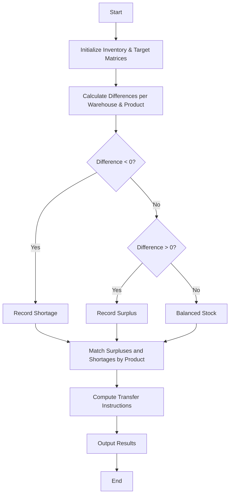

## Problem Statement

Given current inventory levels and specified target stock levels for multiple products across multiple warehouses (represented using nested lists), identify discrepancies (shortages and surpluses) and calculate the required inter-warehouse stock transfers to meet the target inventory levels.

---

## Algorithm

1. **Initialize Data:** Represent warehouses, products, current inventory levels, and target levels using nested lists.
2. **Calculate Differences:** Subtract target stock from current stock for each product in each warehouse to compute the difference matrix.
3. **Identify Discrepancies:**
* If the difference is negative, record it as a **shortage**.
* If the difference is positive, record it as a **surplus**.


4. **Generate Transfer Plan:** Match surpluses to shortages for the same product types to determine transfer quantities and source-destination pairs.
5. **Output Results:** Display differences, shortages, surpluses, and the required transfer instructions.

---

## Flowchart



---

## Python Source Code

```python
def reconcile_inventory(inventory, targets, warehouses, products):
    num_warehouses = len(inventory)
    num_products = len(inventory[0])
    
    diffs = [[inventory[w][p] - targets[w][p] for p in range(num_products)] for w in range(num_warehouses)]
    
    shortages = []
    surpluses = []
    
    for w in range(num_warehouses):
        for p in range(num_products):
            d = diffs[w][p]
            if d < 0:
                shortages.append((w, p, -d))
            elif d > 0:
                surpluses.append((w, p, d))
                
    transfers = []
    s_idx = 0
    t_idx = 0
    
    while s_idx < len(surpluses) and t_idx < len(shortages):
        s_warehouse, s_product, s_qty = surpluses[s_idx]
        t_warehouse, t_product, t_qty = shortages[t_idx]
        
        if s_product == t_product:
            transfer_qty = min(s_qty, t_qty)
            transfers.append((warehouses[s_warehouse], warehouses[t_warehouse], products[s_product], transfer_qty))
            
            if s_qty > t_qty:
                surpluses[s_idx] = (s_warehouse, s_product, s_qty - transfer_qty)
                t_idx += 1
            elif s_qty < t_qty:
                shortages[t_idx] = (t_warehouse, t_product, t_qty - transfer_qty)
                s_idx += 1
            else:
                s_idx += 1
                t_idx += 1
        else:
            t_idx += 1
            
    return diffs, shortages, surpluses, transfers

warehouses = ["Warehouse_A", "Warehouse_B"]
products = ["Product_1", "Product_2"]

inventory = [
    [10, 20],
    [30, 5]
]

targets = [
    [15, 10],
    [20, 15]
]

diffs, shortages, surpluses, transfers = reconcile_inventory(inventory, targets, warehouses, products)

print("Differences Matrix:", diffs)
print("Shortages:", shortages)
print("Surpluses:", surpluses)
print("Required Transfers:", transfers)

```

---

## Sample Input

* **Warehouses:** `["Warehouse_A", "Warehouse_B"]`
* **Products:** `["Product_1", "Product_2"]`
* **Current Inventory Matrix:**
```python
[
    [10, 20],  # Warehouse_A: 10 of Product_1, 20 of Product_2
    [30, 5]    # Warehouse_B: 30 of Product_1, 5 of Product_2
]

```


* **Target Inventory Matrix:**
```python
[
    [15, 10],  # Warehouse_A target: 15 of Product_1, 10 of Product_2
    [20, 15]   # Warehouse_B target: 20 of Product_1, 15 of Product_2
]

```


---

## Sample Output

```text
Differences Matrix: [[-5, 10], [10, -10]]
Shortages: [(0, 0, 5), (1, 1, 10)]
Surpluses: [(0, 1, 10), (1, 0, 10)]
Required Transfers: [('Warehouse_A', 'Warehouse_B', 'Product_2', 10), ('Warehouse_B', 'Warehouse_A', 'Product_1', 5)]

```
