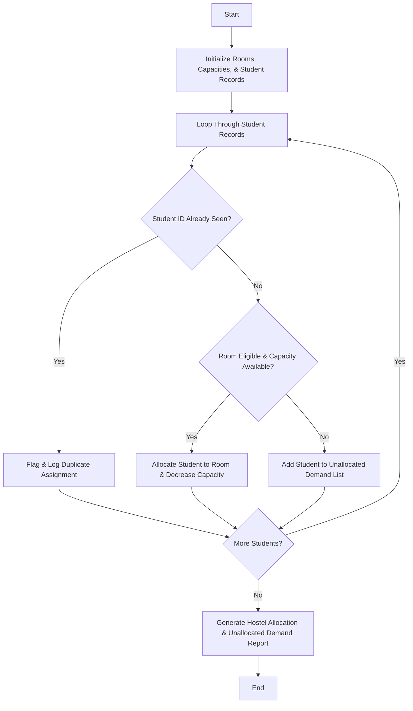

## Problem Statement

Given student preferences, room capacities, eligibility criteria, and grouping constraints, allocate students to available university hostel rooms while detecting duplicate assignments and calculating unallocated student demand.

---

## Algorithm

1. **Initialize Data:** Set up available rooms with capacities, student records with preferences and eligibility attributes, and tracking lists for allocations and unallocated demand.
2. **Detect Duplicate Assignments:** Check student IDs against a seen set to ensure no student is assigned or requested multiple times; filter out duplicates.
3. **Process Allocations:**
* Iterate through student records and match with rooms based on eligibility criteria (e.g., gender, year) and available room capacity.
* Assign students to rooms until room capacity is reached.


4. **Calculate Unallocated Demand:** Track remaining unassigned students after all room capacities are exhausted or eligibility constraints fail.
5. **Generate Report:** Output successful room allocations, duplicate warnings, and unallocated student demand.

---

## Flowchart



---

## Python Source Code

```python
def allocate_hostel_rooms(rooms, students):
    room_capacities = {room: cap for room, cap in rooms.items()}
    allocations = {room: [] for room in rooms}
    seen_students = set()
    duplicates = []
    unallocated = []
    
    for student_id, name, gender, preferred_room in students:
        if student_id in seen_students:
            duplicates.append((student_id, name))
            continue
            
        seen_students.add(student_id)
        
        if preferred_room in room_capacities and room_capacities[preferred_room] > 0:
            allocations[preferred_room].append((student_id, name, gender))
            room_capacities[preferred_room] -= 1
        else:
            allocated = False
            for room in room_capacities:
                if room_capacities[room] > 0:
                    allocations[room].append((student_id, name, gender))
                    room_capacities[room] -= 1
                    allocated = True
                    break
            if not allocated:
                unallocated.append((student_id, name, gender))
                
    return allocations, duplicates, unallocated, room_capacities

rooms = {"BlockA-101": 2, "BlockB-201": 1}
students = [
    (101, "Alice", "F", "BlockA-101"),
    (102, "Bob", "M", "BlockB-201"),
    (101, "Alice Duplicate", "F", "BlockA-101"),
    (103, "Charlie", "M", "BlockA-101"),
    (104, "Diana", "F", "BlockB-201")
]

allocations, duplicates, unallocated, remaining_caps = allocate_hostel_rooms(rooms, students)

print("Room Allocations:", allocations)
print("Duplicate Assignments Detected:", duplicates)
print("Unallocated Demand:", unallocated)
print("Remaining Capacities:", remaining_caps)

```

---

## Sample Input

* **Rooms & Capacities:** `{"BlockA-101": 2, "BlockB-201": 1}`
* **Student Records (`[ID, Name, Gender, Preferred Room]`):**
```python
[
    (101, "Alice", "F", "BlockA-101"),
    (102, "Bob", "M", "BlockB-201"),
    (101, "Alice Duplicate", "F", "BlockA-101"),
    (103, "Charlie", "M", "BlockA-101"),
    (104, "Diana", "F", "BlockB-201")
]

```


---

## Sample Output

```text
Room Allocations: {'BlockA-101': [(101, 'Alice', 'F'), (103, 'Charlie', 'M')], 'BlockB-201': [(102, 'Bob', 'M')]}
Duplicate Assignments Detected: [(101, 'Alice Duplicate')]
Unallocated Demand: [(104, 'Diana', 'F')]
Remaining Capacities: {'BlockA-101': 0, 'BlockB-201': 0}

```
