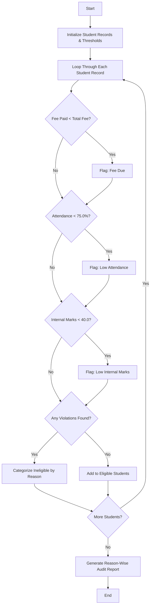

## Problem Statement

Given university student records comprising fee payment status, attendance percentages, and internal marks, perform an integrated eligibility audit. The goal is to identify students who fail to meet any of the examination eligibility criteria, categorize them reason-wise, and generate a comprehensive audit report.

---

## Algorithm

1. **Initialize Parameters:** Define institutional thresholds (e.g., full fee payment required, minimum 75% attendance, minimum 40 internal marks).
2. **Process Records:** Iterate through the list of student records containing ID, name, fee paid, total fee, attendance percentage, and internal marks.
3. **Evaluate Criteria:**
* Check if fee paid is less than the total fee required.
* Check if attendance is below the minimum threshold.
* Check if internal marks are below the passing threshold.


4. **Categorize Status:**
* If all criteria are met, add the student to the **Eligible** list.
* If criteria fail, record the specific violations and group the student into the corresponding reason-wise report category (**Fee Due**, **Low Attendance**, **Low Internal Marks**, or **Multiple Issues**).


5. **Output Audit Report:** Display the list of eligible students and the categorized reason-wise breakdown of ineligible students.

---

## Flowchart



---

## Python Source Code

```python
def audit_eligibility(students):
    eligible_students = []
    ineligible_report = {
        "Fee Due": [],
        "Low Attendance": [],
        "Low Internal Marks": [],
        "Multiple Issues": []
    }
    
    for student in students:
        sid, name, fee_paid, total_fee, attendance, marks = student
        issues = []
        
        if fee_paid < total_fee:
            issues.append("Fee Due")
        if attendance < 75.0:
            issues.append("Low Attendance")
        if marks < 40.0:
            issues.append("Low Internal Marks")
            
        if not issues:
            eligible_students.append((sid, name))
        else:
            if len(issues) > 1:
                ineligible_report["Multiple Issues"].append((sid, name, issues))
            else:
                ineligible_report[issues[0]].append((sid, name))
                
    return eligible_students, ineligible_report

students = [
    (101, "Alice", 5000, 5000, 85.5, 65.0),
    (102, "Bob", 3000, 5000, 78.0, 50.0),
    (103, "Charlie", 5000, 5000, 60.0, 35.0),
    (104, "Diana", 2000, 5000, 65.0, 30.0),
    (105, "Ethan", 5000, 5000, 92.0, 85.0)
]

eligible, report = audit_eligibility(students)

print("Eligible Students:", eligible)
print("Ineligible Report by Reason:", report)

```

---

## Sample Input

* **Thresholds:** Minimum Attendance = 75.0%, Minimum Internal Marks = 40.0, Full Fee Required.
* **Student Records (ID, Name, Fee Paid, Total Fee, Attendance %, Internal Marks):**
```python
[
    (101, "Alice", 5000, 5000, 85.5, 65.0),
    (102, "Bob", 3000, 5000, 78.0, 50.0),
    (103, "Charlie", 5000, 5000, 60.0, 35.0),
    (104, "Diana", 2000, 5000, 65.0, 30.0),
    (105, "Ethan", 5000, 5000, 92.0, 85.0)
]

```


---

## Sample Output

```text
Eligible Students: [(101, 'Alice'), (105, 'Ethan')]
Ineligible Report by Reason: {'Fee Due': [(102, 'Bob')], 'Low Attendance': [(103, 'Charlie')], 'Low Internal Marks': [], 'Multiple Issues': [(104, 'Diana', ['Fee Due', 'Low Attendance', 'Low Internal Marks'])]}

```
