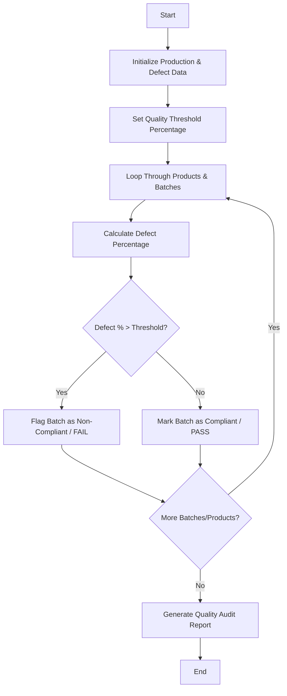

## Problem Statement

Given production quantities and defective unit counts across multiple products and batches, compute the defect percentage for each batch and identify batches exceeding a specified quality threshold.

---

## Algorithm

1. **Initialize Parameters:** Define the maximum allowable defect percentage threshold (e.g., 5.0%).
2. **Process Batches:** Iterate through each product and its corresponding batches containing production and defect counts.
3. **Calculate Defect Percentage:** For each batch, compute the defect rate using the formula: $(\text{defective units} / \text{production quantity}) \times 100$.
4. **Evaluate Quality Status:**
* If the defect percentage exceeds the threshold, flag the batch as **FAIL**.
* Otherwise, mark the batch as **PASS**.


5. **Generate Report:** Compile the complete audit matrix and a separate list of flagged non-compliant batches.

---

## Flowchart



---

## Python Source Code

```python
def quality_control_audit(production_data, threshold):
    audit_results = []
    flagged_batches = []
    
    for prod_idx, batches in enumerate(production_data):
        product_results = []
        for batch_idx, (prod_qty, def_qty) in enumerate(batches):
            defect_pct = (def_qty / prod_qty) * 100 if prod_qty > 0 else 0.0
            status = "FAIL" if defect_pct > threshold else "PASS"
            product_results.append((batch_idx, prod_qty, def_qty, round(defect_pct, 2), status))
            if status == "FAIL":
                flagged_batches.append((prod_idx, batch_idx, round(defect_pct, 2)))
        audit_results.append(product_results)
        
    return audit_results, flagged_batches

threshold = 5.0
production_data = [
    [(1000, 20), (500, 35), (800, 10)],
    [(1200, 70), (600, 12)]
]

results, flagged = quality_control_audit(production_data, threshold)

print("Audit Results Matrix:", results)
print("Flagged Batches Exceeding Threshold:", flagged)

```

---

## Sample Input

* **Quality Threshold:** `5.0%`
* **Production Data (List of Products, each containing batches of `[Produced Quantity, Defective Units]`):**
```python
[
    [(1000, 20), (500, 35), (800, 10)],  # Product 0: 3 batches
    [(1200, 70), (600, 12)]               # Product 1: 2 batches
]

```


---

## Sample Output

```text
Audit Results Matrix: [[(0, 1000, 20, 2.0, 'PASS'), (1, 500, 35, 7.0, 'FAIL'), (2, 800, 10, 1.25, 'PASS')], [(0, 1200, 70, 5.83, 'FAIL'), (1, 600, 12, 2.0, 'PASS')]]
Flagged Batches Exceeding Threshold: [(0, 1, 7.0), (1, 0, 5.83)]

```
