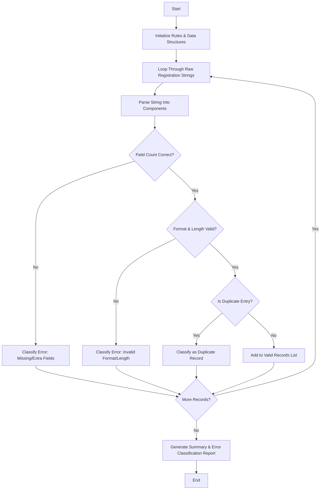

## Problem Statement

Given a list of structured registration strings, parse the records into individual components, validate field lengths and formats (e.g., alphanumeric IDs, email format, and specific date patterns), detect duplicate entries, and classify any validation errors into a structured error report.

---

## Algorithm

1. **Initialize Parameters:** Define expected field delimiters, format regular expressions, and storage lists for valid records, duplicates, and error logs.
2. **Iterate Through Records:** Process each raw registration string sequentially.
3. **Parse Fields:** Split the string by the specified delimiter into distinct components (e.g., Registration ID, Name, Email, Date).
4. **Perform Validation Checks:**
* Check if the total number of expected fields matches.
* Validate field formats using regular expressions (e.g., valid email pattern, alphanumeric ID).
* Check against existing records to detect duplicate entries.


5. **Classify and Record:**
* If valid and unique, add to the processed records list.
* If duplicate, tag under duplicate records.
* If invalid, classify the specific failure (e.g., "Invalid Format", "Missing Field", "Length Error") and add to the error classification report.


6. **Output Results:** Display valid records, duplicate logs, and the classified error report.

---

## Flowchart



---

## Python Source Code

```python
import re

def analyze_registrations(records):
    valid_records = []
    duplicate_records = []
    error_report = {
        "Field Count Error": [],
        "Format Error": [],
        "Length Error": []
    }
    seen_ids = set()
    
    email_regex = r"^[\w\.-]+@[\w\.-]+\.\w+$"
    id_regex = r"^REG\d{3}$"
    
    for record in records:
        parts = record.split(",")
        parts = [p.strip() for p in parts]
        
        if len(parts) != 4:
            error_report["Field Count Error"].append(record)
            continue
            
        reg_id, name, email, date_str = parts
        
        if not re.match(id_regex, reg_id) or len(reg_id) != 6:
            error_report["Length Error" if len(reg_id) != 6 else "Format Error"].append((record, "Invalid ID"))
            continue
            
        if not re.match(email_regex, email):
            error_report["Format Error"].append((record, "Invalid Email"))
            continue
            
        if reg_id in seen_ids:
            duplicate_records.append(record)
        else:
            seen_ids.add(reg_id)
            valid_records.append((reg_id, name, email, date_str))
            
    return valid_records, duplicate_records, error_report

raw_records = [
    "REG001, Alice Smith, alice@example.com, 2026-03-01",
    "REG002, Bob Jones, bob.jones@domain.org, 2026-03-02",
    "REG001, Alice Duplicate, alice.dup@example.com, 2026-03-03",
    "REGX99, Charlie, charlie@example.com, 2026-03-04",
    "REG003, Diana, invalid-email, 2026-03-05",
    "REG004, Extra, field, data, 2026-03-06"
]

valid, duplicates, errors = analyze_registrations(raw_records)

print("Valid Records:", valid)
print("Duplicate Records:", duplicates)
print("Error Report:", errors)

```

---

## Sample Input

* **Raw Registration Strings (Format: ID, Name, Email, Date):**
```python
[
    "REG001, Alice Smith, alice@example.com, 2026-03-01",
    "REG002, Bob Jones, bob.jones@domain.org, 2026-03-02",
    "REG001, Alice Duplicate, alice.dup@example.com, 2026-03-03",
    "REGX99, Charlie, charlie@example.com, 2026-03-04",
    "REG003, Diana, invalid-email, 2026-03-05",
    "REG004, Extra, field, data, 2026-03-06"
]

```


---

## Sample Output

```text
Valid Records: [('REG001', 'Alice Smith', 'alice@example.com', '2026-03-01'), ('REG002', 'Bob Jones', 'bob.jones@domain.org', '2026-03-02')]
Duplicate Records: ['REG001, Alice Duplicate, alice.dup@example.com, 2026-03-03']
Error Report: {'Field Count Error': ['REG004, Extra, field, data, 2026-03-06'], 'Format Error': [('REGX99, Charlie, charlie@example.com, 2026-03-04', 'Invalid ID'), ('REG003, Diana, invalid-email, 2026-03-05', 'Invalid Email')], 'Length Error': []}

```
