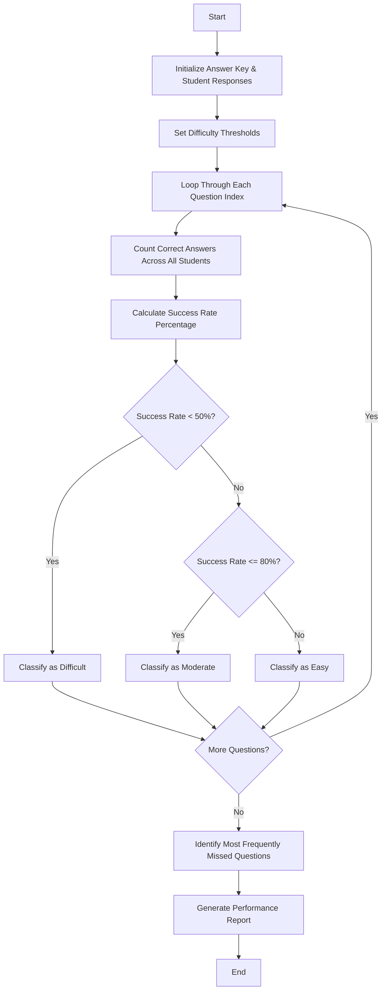

## Problem Statement

Given an answer key and a list of student response strings, compare each student's answers against the correct key, calculate question-wise success rates, identify the most frequently missed questions, and classify the difficulty level of each question.

---

## Algorithm

1. **Initialize Parameters:** Define the answer key and classification thresholds (e.g., success rate < 50% for "Difficult", 50%–80% for "Moderate", > 80% for "Easy").
2. **Process Responses:** Iterate through each student's answer string and compare character-by-character with the answer key.
3. **Calculate Success Rates:** Count the number of correct responses for each question index across all students and compute the percentage success rate.
4. **Identify Missed Questions:** Rank questions by the number of incorrect responses to find the most frequently missed questions.
5. **Classify Question Performance:** Assign a difficulty tag ("Easy", "Moderate", "Difficult") to each question based on its success rate.
6. **Output Results:** Display question-wise success rates, performance classifications, and top missed questions.

---

## Flowchart



---

## Python Source Code

```python
def analyze_exam_performance(answer_key, student_responses):
    num_questions = len(answer_key)
    num_students = len(student_responses)
    correct_counts = [0] * num_questions
    
    for response in student_responses:
        for q_idx in range(num_questions):
            if q_idx < len(response) and response[q_idx] == answer_key[q_idx]:
                correct_counts[q_idx] += 1
                
    success_rates = []
    classifications = []
    
    for q_idx in range(num_questions):
        rate = (correct_counts[q_idx] / num_students) * 100
        success_rates.append(round(rate, 2))
        
        if rate < 50.0:
            classification = "Difficult"
        elif rate <= 80.0:
            classification = "Moderate"
        else:
            classification = "Easy"
            
        classifications.append((q_idx + 1, round(rate, 2), classification))
        
    missed_questions = sorted(classifications, key=lambda x: x[1])
    
    return success_rates, classifications, missed_questions

answer_key = "ABCAD"
student_responses = [
    "ABCAD",
    "ABCCD",
    "ABCAA",
    "BBCAD",
    "ABBAD"
]

rates, classifications, missed = analyze_exam_performance(answer_key, student_responses)

print("Success Rates (%):", rates)
print("Question Classifications:", classifications)
print("Ranked by Missed Frequency:", missed)

```

---

## Sample Input

* **Answer Key:** `"ABCAD"`
* **Student Answer Strings:**
```python
[
    "ABCAD",  # Student 1 (All correct)
    "ABCCD",  # Student 2 (1 error at Q3)
    "ABCAA",  # Student 3 (1 error at Q5)
    "BBCAD",  # Student 4 (1 error at Q1)
    "ABBAD"   # Student 5 (1 error at Q3)
]

```


---

## Sample Output

```text
Success Rates (%): [80.0, 80.0, 60.0, 100.0, 80.0]
Question Classifications: [(1, 80.0, 'Moderate'), (2, 80.0, 'Moderate'), (3, 60.0, 'Moderate'), (4, 100.0, 'Easy'), (5, 80.0, 'Moderate')]
Ranked by Missed Frequency: [(3, 60.0, 'Moderate'), (1, 80.0, 'Moderate'), (2, 80.0, 'Moderate'), (5, 80.0, 'Moderate'), (4, 100.0, 'Easy')]

```
