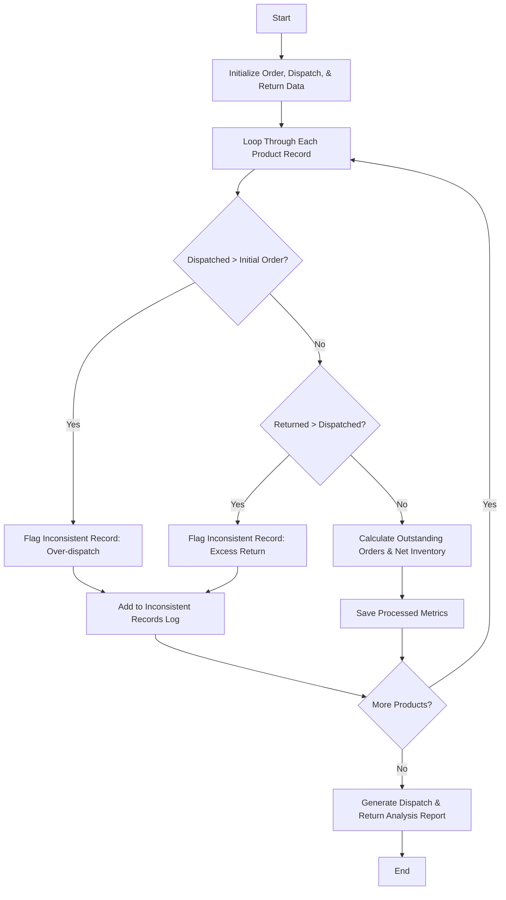

## Problem Statement

Given initial order quantities, dispatch records, and returned quantities for multiple products, calculate outstanding orders, update final warehouse inventory levels, and detect inconsistent records (e.g., returned quantities exceeding dispatched quantities or dispatched orders exceeding initial orders).

---

## Algorithm

1. **Initialize Data:** Define initial orders, dispatched quantities, and returned quantities across products.
2. **Process Records:** Iterate through each product entry to validate and compute transaction metrics.
3. **Perform Validation Checks:**
* Check if dispatched quantity is greater than initial order quantity.
* Check if returned quantity is greater than dispatched quantity.


4. **Calculate Metrics:**
* Compute **outstanding orders** as initial orders minus dispatched quantities plus returned quantities (or remaining fulfillment required).
* Compute **net inventory update** based on initial inventory, dispatched units, and returns.


5. **Generate Report:** Compile valid processing results and flag any inconsistent records.

---

## Flowchart



---

## Python Source Code

```python
def analyze_orders(product_names, initial_orders, dispatched, returned):
    processed_results = []
    inconsistent_records = []
    
    for i in range(len(product_names)):
        name = product_names[i]
        ordered = initial_orders[i]
        disp = dispatched[i]
        ret = returned[i]
        
        if disp > ordered:
            inconsistent_records.append((name, "Dispatched exceeds Initial Order"))
            continue
            
        if ret > disp:
            inconsistent_records.append((name, "Returned exceeds Dispatched Quantity"))
            continue
            
        outstanding = ordered - disp
        net_inventory_change = disp - ret
        
        processed_results.append((name, outstanding, net_inventory_change))
        
    return processed_results, inconsistent_records

product_names = ["Item_A", "Item_B", "Item_C"]
initial_orders = [100, 200, 150]
dispatched = [90, 210, 150]
returned = [5, 10, 20]

results, inconsistencies = analyze_orders(product_names, initial_orders, dispatched, returned)

print("Processed Results (Product, Outstanding, Net Dispatched):", results)
print("Inconsistent Records:", inconsistencies)

```

---

## Sample Input

* **Products:** `["Item_A", "Item_B", "Item_C"]`
* **Initial Orders:** `[100, 200, 150]`
* **Dispatched Quantities:** `[90, 210, 150]`
* **Returned Quantities:** `[5, 10, 20]`

---

## Sample Output

```text
Processed Results (Product, Outstanding, Net Dispatched): [('Item_A', 10, 85), ('Item_C', 0, 130)]
Inconsistent Records: [('Item_B', 'Dispatched exceeds Initial Order')]

```
