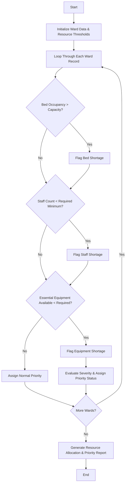

## Problem Statement

Given nested lists of bed occupancy, available staff, and medical equipment across multiple hospital wards, analyze resource levels against required thresholds, identify shortages, and prioritize critical wards using predefined allocation and severity rules.

---

## Algorithm

1. **Initialize Parameters:** Define institutional minimum requirements for bed capacity ratios, staff-to-patient ratios, and critical equipment per ward.
2. **Process Ward Data:** Iterate through the nested lists representing each ward's current bed occupancy, available staff, and equipment counts.
3. **Evaluate Resource Metrics:**
* Compute bed occupancy percentages and check against maximum capacity thresholds.
* Calculate staff shortages based on required minimum staff per patient.
* Check for missing or insufficient essential equipment.


4. **Prioritize Cases:** Assign priority rankings (e.g., Critical, Moderate, Normal) based on the severity and multiplicity of resource shortages.
5. **Generate Report:** Compile resource deficit findings and prioritization lists for administrative action.

---

## Flowchart



---

## Python Source Code

```python
def analyze_hospital_resources(wards, occupancy_data, staff_data, equipment_data, thresholds):
    report = []
    
    for i in range(len(wards)):
        ward_name = wards[i]
        beds_occ, max_beds = occupancy_data[i]
        staff_avail, min_staff = staff_data[i]
        equip_avail, min_equip = equipment_data[i]
        
        shortages = []
        
        if beds_occ > max_beds:
            shortages.append("Bed Overflow")
        if staff_avail < min_staff:
            shortages.append("Staff Shortage")
        if equip_avail < min_equip:
            shortages.append("Equipment Shortage")
            
        if len(shortages) >= 2:
            priority = "Critical"
        elif len(shortages) == 1:
            priority = "Moderate"
        else:
            priority = "Normal"
            
        report.append((ward_name, priority, shortages))
        
    return report

wards = ["ICU", "Emergency", "General Ward"]
occupancy_data = [(15, 12), (30, 30), (40, 50)]
staff_data = [(8, 10), (12, 10), (15, 20)]
equipment_data = [(5, 6), (8, 8), (10, 10)]

thresholds = {}

results = analyze_hospital_resources(wards, occupancy_data, staff_data, equipment_data, thresholds)

print("Hospital Resource Allocation Report:", results)

```

---

## Sample Input

* **Wards:** `["ICU", "Emergency", "General Ward"]`
* **Bed Occupancy Data (`[Occupied, Max Capacity]`):** `[(15, 12), (30, 30), (40, 50)]`
* **Staff Data (`[Available Staff, Required Minimum]`):** `[(8, 10), (12, 10), (15, 20)]`
* **Equipment Data (`[Available Equipment, Required Minimum]`):** `[(5, 6), (8, 8), (10, 10)]`

---

## Sample Output

```text
Hospital Resource Allocation Report: [('ICU', 'Critical', ['Bed Overflow', 'Staff Shortage', 'Equipment Shortage']), ('Emergency', 'Normal', []), ('General Ward', 'Moderate', ['Staff Shortage'])]

```
