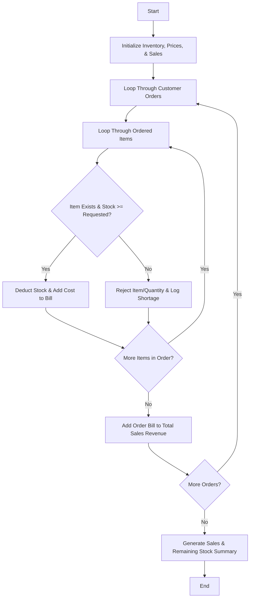

## Problem Statement

Given initial stock levels and item prices, process successive customer orders sequentially. For each order, calculate the total bill, update available inventory in real-time, reject any items or quantities that exceed current stock, and generate a daily summary of total sales revenue and remaining stock.

---

## Algorithm

1. **Initialize Data:** Define menu items, initial stock quantities, and prices. Set initial daily sales revenue to zero.
2. **Process Orders:** Iterate through each customer order containing requested items and quantities.
3. **Verify Inventory:** For each requested item in an order:
* Check if the item exists and if the ordered quantity is less than or equal to the currently available stock.
* If available, deduct the ordered quantity from stock and add to the order's bill.
* If unavailable or insufficient, reject the specific item or portion and log the rejection.


4. **Update Revenue:** Add valid order totals to cumulative daily sales.
5. **Generate Summary:** Output total sales revenue, completed orders, rejected items, and final remaining stock levels.

---

## Flowchart



---

## Python Source Code

```python
def process_canteen_orders(menu_stock, prices, orders):
    stock = menu_stock.copy()
    total_sales = 0.0
    processed_orders = []
    
    for order_id, order_items in enumerate(orders):
        bill = 0.0
        accepted_items = []
        rejected_items = []
        
        for item, qty in order_items.items():
            if item in stock and stock[item] >= qty:
                stock[item] -= qty
                bill += qty * prices[item]
                accepted_items.append((item, qty))
            else:
                available = stock.get(item, 0)
                rejected_items.append((item, qty, available))
                if available > 0:
                    stock[item] = 0
                    bill += available * prices[item]
                    accepted_items.append((item, available))
                    
        total_sales += bill
        processed_orders.append((order_id + 1, accepted_items, rejected_items, round(bill, 2)))
        
    return total_sales, stock, processed_orders

menu_stock = {"Burger": 10, "Pizza": 5, "Soda": 20}
prices = {"Burger": 5.50, "Pizza": 12.00, "Soda": 2.00}

orders = [
    {"Burger": 3, "Soda": 5},
    {"Pizza": 6, "Soda": 10},
    {"Burger": 8, "Pizza": 2}
]

sales, remaining_stock, order_summary = process_canteen_orders(menu_stock, prices, orders)

print("Total Sales Revenue:", sales)
print("Remaining Stock:", remaining_stock)
print("Order Summary:", order_summary)

```

---

## Sample Input

* **Initial Stock:** `{"Burger": 10, "Pizza": 5, "Soda": 20}`
* **Item Prices:** `{"Burger": 5.50, "Pizza": 12.00, "Soda": 2.00}`
* **Customer Orders:**
```python
[
    {"Burger": 3, "Soda": 5},       # Order 1: Valid
    {"Pizza": 6, "Soda": 10},      # Order 2: Pizza exceeds stock (only 5 left)
    {"Burger": 8, "Pizza": 2}      # Order 3: Burger exceeds remaining stock
]

```


---

## Sample Output

```text
Total Sales Revenue: 132.5
Remaining Stock: {'Burger': 0, 'Pizza': 0, 'Soda': 5}
Order Summary: [(1, [('Burger', 3), ('Soda', 5)], [], 26.5), (2, [('Pizza', 5), ('Soda', 10)], [('Pizza', 6, 5)], 80.0), (3, [('Burger', 7)], [('Burger', 8, 7), ('Pizza', 2, 0)], 38.5)]

```
