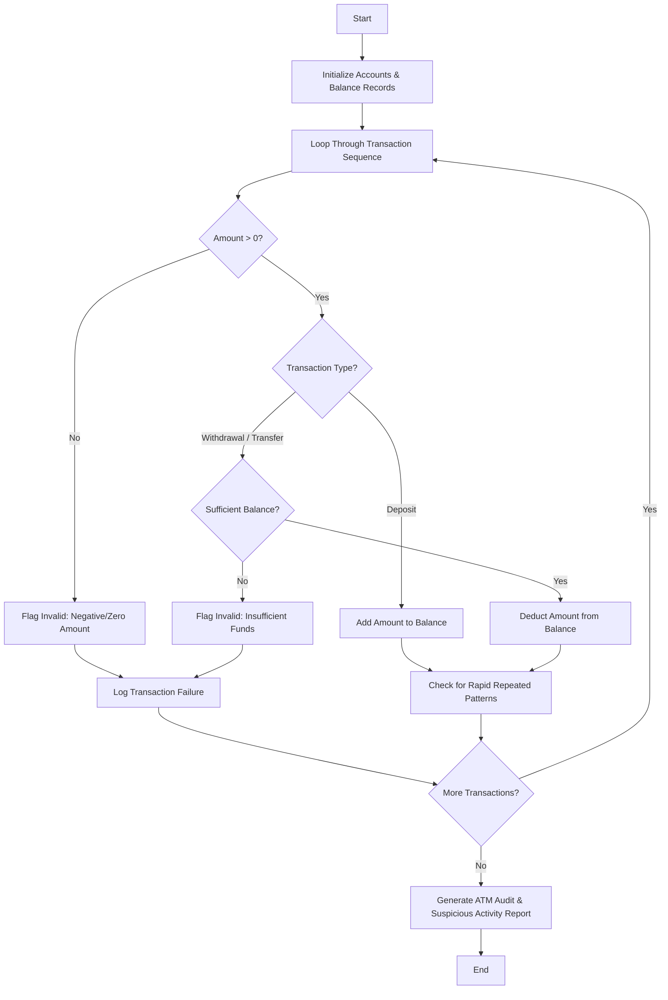

## Problem Statement

Given a sequence of ATM transactions (deposits, withdrawals, and transfers) across simulated accounts, maintain account balances, detect invalid operations (e.g., withdrawals exceeding available balance, negative amounts), and identify suspicious patterns such as repeated rapid transactions.

---

## Algorithm

1. **Initialize Data:** Set up initial account balances and define fraud detection thresholds (e.g., maximum transaction limits or rapid repetition limits).
2. **Process Transactions:** Sequentially evaluate each transaction record containing transaction type, account ID, amount, and timestamp/sequence.
3. **Validate Operations:**
* Check if transaction amount is positive.
* For withdrawals and outgoing transfers, check if the account has sufficient balance.
* If invalid, flag and log the operation.


4. **Detect Suspicious Patterns:** Analyze transaction frequency and amounts to flag suspicious repeated patterns (e.g., multiple rapid withdrawals).
5. **Generate Report:** Output final account balances, a list of invalid transactions, and flagged suspicious activity logs.

---

## Flowchart



---

## Python Source Code

```python
def audit_atm_transactions(accounts, transactions):
    balances = accounts.copy()
    audit_log = []
    suspicious_patterns = []
    recent_transactions = {}
    
    for tx_id, (acc_id, tx_type, amount) in enumerate(transactions):
        if amount <= 0:
            audit_log.append((tx_id, acc_id, tx_type, amount, "Invalid Amount"))
            continue
            
        if tx_type == "Deposit":
            balances[acc_id] = balances.get(acc_id, 0.0) + amount
            audit_log.append((tx_id, acc_id, tx_type, amount, "SUCCESS"))
            
        elif tx_type in ["Withdrawal", "Transfer"]:
            current_bal = balances.get(acc_id, 0.0)
            if current_bal < amount:
                audit_log.append((tx_id, acc_id, tx_type, amount, "Insufficient Funds"))
            else:
                balances[acc_id] = current_bal - amount
                audit_log.append((tx_id, acc_id, tx_type, amount, "SUCCESS"))
                
                if acc_id not in recent_transactions:
                    recent_transactions[acc_id] = []
                recent_transactions[acc_id].append((tx_type, amount))
                
                if len(recent_transactions[acc_id]) >= 3:
                    suspicious_patterns.append((acc_id, "Rapid Successive Withdrawals/Transfers Detected"))
                    
    return balances, audit_log, suspicious_patterns

initial_accounts = {"ACC101": 1000.0, "ACC102": 500.0}
transaction_sequence = [
    ("ACC101", "Deposit", 200.0),
    ("ACC101", "Withdrawal", 300.0),
    ("ACC101", "Withdrawal", 200.0),
    ("ACC101", "Withdrawal", 100.0),
    ("ACC102", "Withdrawal", 800.0),
    ("ACC102", "Deposit", -50.0)
]

final_balances, audit_report, suspicious = audit_atm_transactions(initial_accounts, transaction_sequence)

print("Final Balances:", final_balances)
print("Audit Log:", audit_report)
print("Suspicious Patterns:", suspicious)

```

---

## Sample Input

* **Initial Accounts:** `{"ACC101": 1000.0, "ACC102": 500.0}`
* **Transaction Sequence `(Account ID, Type, Amount)`:**
```python
[
    ("ACC101", "Deposit", 200.0),
    ("ACC101", "Withdrawal", 300.0),
    ("ACC101", "Withdrawal", 200.0),
    ("ACC101", "Withdrawal", 100.0),
    ("ACC102", "Withdrawal", 800.0),
    ("ACC102", "Deposit", -50.0)
]

```


---

## Sample Output

```text
Final Balances: {'ACC101': 600.0, 'ACC102': 500.0}
Audit Log: [(0, 'ACC101', 'Deposit', 200.0, 'SUCCESS'), (1, 'ACC101', 'Withdrawal', 300.0, 'SUCCESS'), (2, 'ACC101', 'Withdrawal', 200.0, 'SUCCESS'), (3, 'ACC101', 'Withdrawal', 100.0, 'SUCCESS'), (4, 'ACC102', 'Withdrawal', 800.0, 'Insufficient Funds'), (5, 'ACC102', 'Deposit', -50.0, 'Invalid Amount')]
Suspicious Patterns: [('ACC101', 'Rapid Successive Withdrawals/Transfers Detected')]

```
